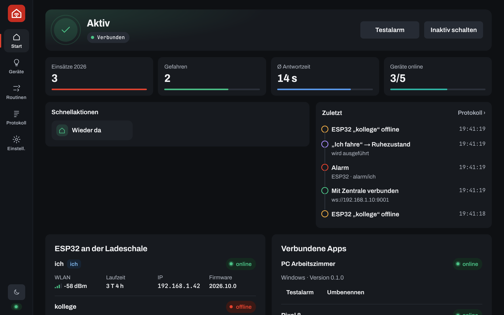
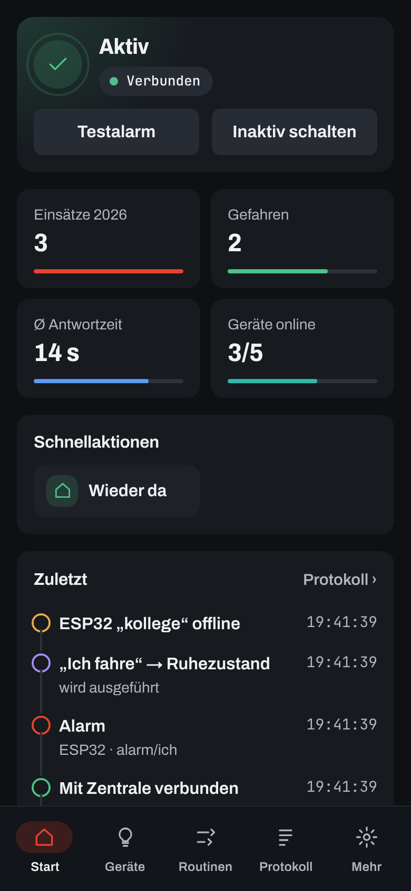
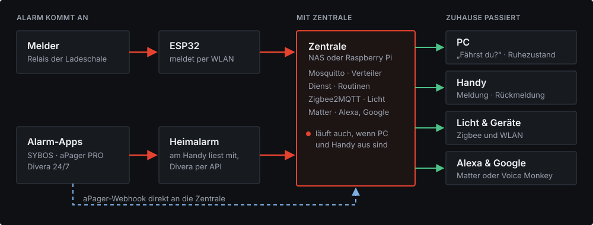
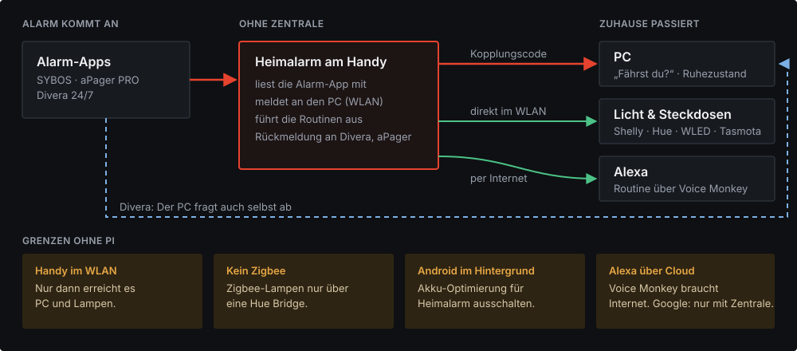
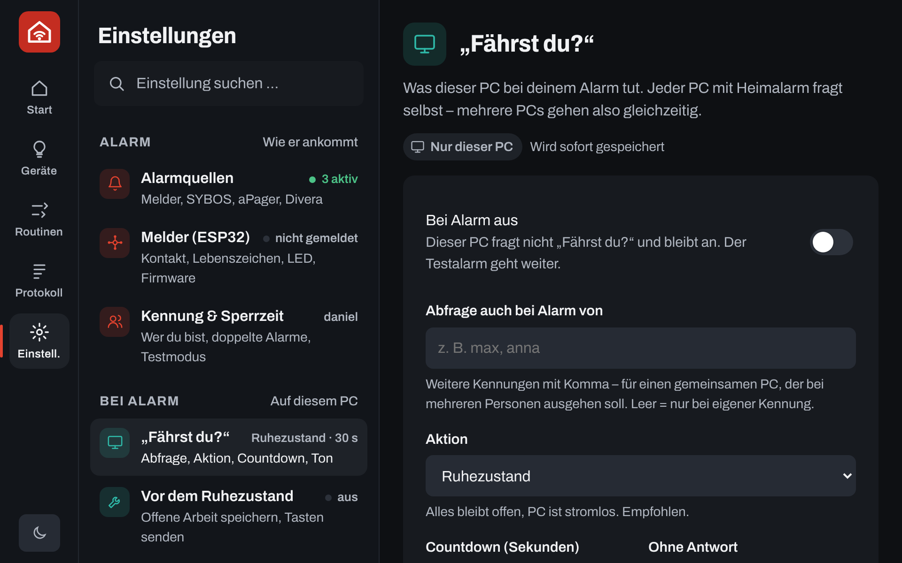
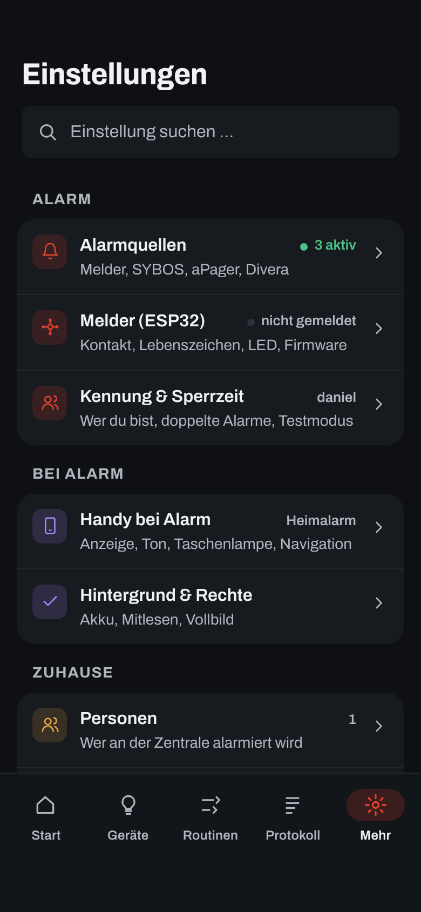

<p align="center"></p>

<h1 align="center">Heimalarm</h1>
<p align="center">Einsatz-Alarme zuhause weitergeben.</p>

---

## Was ist Heimalarm?

Heimalarm ist für Einsatzkräfte, die zuhause alarmiert werden: Feuerwehr, Rettungsdienst, Wasserwacht oder Katastrophenschutz. Kommt ein Alarm, passiert zuhause Folgendes:

- **PC:** Ein Vollbild fragt „Fährst du?“, auf jedem Bildschirm und mit Ton in einstellbarer Lautstärke. Danach geht der PC in den Ruhezustand. Offene Programme bleiben dabei offen.
- **Handy:** Der Alarm erscheint groß, auch auf dem Sperrbildschirm, mit Stichwort und Adresse. Auf Wunsch mit eigenem Alarmton. Rückmelden geht mit einem Tipp.
- **Licht und Sprachassistenten:** Nachts geht das Flurlicht gedimmt an, Alexa oder Google sagen „Einsatz!“ an.

Alles läuft lokal im Heimnetz und kostet nichts. Cloud-Dienste (Divera, aPager-Rückmeldung, Voice Monkey) nutzt Heimalarm nur, wenn du sie selbst einschaltest.

<p align="center">
  
  
</p>

Oben auf *Start* steht immer, ob Heimalarm bereit ist: Aktiv, Verbindet (prüft gerade Zentrale, Melder, PCs und Divera) oder Inaktiv. Darunter wählst du deine Bereitschaft: Verfügbar, Nicht verfügbar oder Abwesend. Bei den letzten beiden passiert bei Alarm nichts. Du legst fest, bis wann das gilt, danach bist du von selbst wieder verfügbar. PC und Handy zeigen dasselbe, am Handy untereinander.

## So funktioniert es

Heimalarm kennt zwei Betriebsarten. Du wählst sie in der App unter *Einstellungen → Betrieb & Koppeln*.

### Welcher Aufbau passt?

| Du hast … | Dann |
|---|---|
| nur Handy und PC, Alarm kommt über SYBOS, aPager oder Divera | Ohne Zentrale, mehr brauchst du nicht |
| ein Gerät, das immer läuft (z. B. UGREEN-NAS, Synology, Raspberry Pi, Heimserver) | Mit Zentrale, dazu der Melder in der Ladeschale |
| einen Melder in der Ladeschale | Mit Zentrale und einem ESP32 am Relaiskontakt (ca. 10 €) |

Die Zentrale ist kein bestimmtes Gerät, sondern ein kleines Docker-Projekt (`zentrale/`). Sie läuft überall, wo Docker läuft. Einen Raspberry Pi brauchst du dafür nicht. Anleitung für die UGREEN-NAS: [docs/Einrichtung-NAS.md](docs/Einrichtung-NAS.md).

**Mit Zentrale (NAS oder Raspberry Pi):** Alles läuft auch, wenn PC und Handy aus sind.

<p align="center"></p>

**Ohne Zentrale:** Handy und PC arbeiten direkt zusammen. Das reicht, wenn der Alarm nur über SYBOS, aPager oder Divera kommt.

<p align="center"></p>

| | Mit Zentrale | Ohne Zentrale |
|---|---|---|
| PC herunterfahren | ✅ | ✅ Handy meldet an den PC, Divera fragt der PC selbst ab |
| Melder in der Ladeschale (ESP32) | ✅ | – |
| WLAN-Lampen und Steckdosen | ✅ | ✅ Handy schaltet direkt |
| Zigbee-Lampen | ✅ | nur über eine Hue Bridge |
| Alexa | ✅ Matter (lokal) oder Voice Monkey | ✅ Voice Monkey |
| Google Home | ✅ Matter (lokal) | – |
| Matter-Geräte aus Alexa, Google & Co. steuern | ✅ Matter (lokal) | – |
| Routinen | ✅ laufen auf der Zentrale | ✅ laufen auf dem Handy |
| Läuft, wenn das Handy aus oder unterwegs ist | ✅ | – |

## Funktionen

| | |
|---|---|
| Alarmquellen | Melder (ESP32), SYBOS, aPager PRO, Divera 24/7, auch mehrere gleichzeitig. Kommt derselbe Alarm doppelt an, wird daraus ein Einsatz. |
| „Fährst du?“ am PC | Vollbild auf allen Bildschirmen mit Countdown. Danach Ruhezustand, Sperren, Herunterfahren oder nichts. Dazu Ausnahmen (z. B. wenn OBS läuft), Ruhezeiten und Medien anhalten. |
| Alarmton | Melder-Ton oder eigener Ton (MP3, WAV, OGG, FLAC) auf PC und Handy. Mit „Ton testen“ hörst du, wie laut es wird. Am PC hebt Heimalarm auf Wunsch die Windows-Lautstärke an, am Handy klingelt es wie ein Wecker, auch im Lautlos-Modus. |
| Alarm am Handy | Vollbild über dem Sperrbildschirm mit Vibration und „Ich fahre / nicht“. Startet nach einem Neustart des Handys von selbst. |
| Rückmeldung | „Ich fahre / nicht“ geht an Divera (Rückmeldung und Status) und an aPager (Zu- oder Absage). |
| Divera-Status | Eigenen Status auf *Start* mit einem Tipp setzen, auf Wunsch mit automatischem Zurücksetzen. |
| Licht und Geräte | WLAN-Geräte (Shelly, Hue, WLED, Tasmota) und Heizkörperthermostate direkt im Heimnetz, mit Zentrale auch Zigbee und Matter. Eine Hersteller-Cloud ist nicht nötig. |
| Ohne Zentrale | Handy und PC koppeln sich mit einem Code im WLAN. Das Handy meldet Alarme an den PC und führt die Routinen aus. |
| Routinen | Auslöser sind Alarm, Uhrzeit oder ein Gerät. Aktionen sind Licht, Gruppen, Verzögerung und „Wieder da“. Bedingungen wie Nacht, dunkel, Wochentag oder Stichwort. Jede Person hat eigene Routinen. |
| Alexa und Google Home | Ein Alarm startet dort Routinen, etwa eine Ansage oder Licht. Lokal über Matter (mit Zentrale) oder Alexa über Voice Monkey (auch ohne). |
| Mehrere Personen | Jede Person hat eine eigene Kennung, eigene Routinen und einen eigenen Melder. |
| Start | Status mit Verbindungsprüfung, Bereitschaft, Kennzahlen, Licht zum Schalten, Schnellaktionen und „Zuletzt“. Es erscheint nur, was eingerichtet ist. |
| Einsätze | Jeder Einsatz mit allen Infos und Notizen, dazu Statistik, Jahresrückblick und CSV-Export. |
| Test und Diagnose | Testalarm, Melder-Alarm nachspielen, Generalprobe, Verbindungstest und ein automatischer Selbsttest (Tage und Uhrzeit einstellbar, abschaltbar). Was jeder Test auslöst, steht in der App unter *Test & Diagnose*. |
| Am PC (optional) | Discord-Status bei Einsatz und Tastendrücke vor dem Ruhezustand (z. B. Speichern in einem Programm). Zu finden unter *Einstellungen → Vor dem Ruhezustand* bzw. *Discord*. |
| Home Assistant | Mit Zentrale taucht Heimalarm von selbst in Home Assistant auf (über MQTT). Einstellung unter *Einstellungen → Alexa, Google & HA*. |
| Datenschutz | Alles bleibt im Heimnetz. App-PIN, Admin-PIN und API-Schlüssel bleiben auf dem Gerät. |
| Bedienung | Dunkel (Standard) oder hell, jeder Bereich hat eine eigene Farbe. Einstellungen, Geräte, Routinen und Protokoll in zwei Spalten, am Handy als Liste mit Unterseite. Einstellungen gleichen sich zwischen den Geräten ab. |

## Kompatible Geräte

| Gerät | Ohne Zentrale | Mit Zentrale | Hinweis |
|---|---|---|---|
| Shelly (Schalter, Stecker, Dimmer) | ✅ | ✅ | direkt im WLAN, Gen1 bis Gen3 |
| Philips Hue | ✅ | ✅ | über die Hue Bridge; zum Koppeln den Knopf drücken |
| IKEA (Tradfri, Dirigera-Lampen) | ✅ über Hue Bridge | ✅ | mit Zentrale direkt per Zigbee-Stick |
| WLED (LED-Streifen) | ✅ | ✅ | |
| Tasmota | ✅ | ✅ | umgeflashte Stecker und Lampen |
| Tuya / Smart Life | über Alexa-Routine | ✅ Zigbee-Geräte | WLAN-Geräte nur über die Tuya-Cloud: per Voice Monkey eine Alexa-Routine starten, die sie schaltet |
| FRITZ! Heizkörperregler (FRITZ!Smart Thermo 301/302, FRITZ!DECT 301/302, Comet DECT) | ✅ | ✅ | über die FRITZ!Box; dort einen eigenen Benutzer mit dem Recht „Smart Home“ anlegen |
| Shelly BLU TRV | ✅ | ✅ | über das Shelly BLU Gateway Gen3 |
| Zigbee-Thermostate (z. B. Sonoff TRVZB, TRV Gen2, Bosch, Aqara E1) | – | ✅ | über Zigbee2MQTT, braucht einen Zigbee-Stick |
| Matter-Thermostate (z. B. Eve Thermo, tado X) | – | ✅ Matter | erst in Alexa, Google oder Apple einrichten, dann teilen; Thread braucht einen Thread-Router |
| Zigbee allgemein | – | ✅ | tausende Geräte, siehe [Zigbee2MQTT](https://www.zigbee2mqtt.io/supported-devices/) |
| Amazon Echo | ✅ Voice Monkey | ✅ Matter oder Voice Monkey | für den lokalen Weg ein Echo mit Matter |
| Google Nest / Home | – | ✅ Matter | Nest Hub, Nest-Lautsprecher oder Google TV |

**Heizung in Routinen:** Die Aktion „+ Heizung“ stellt ein Thermostat auf eine Temperatur oder aus (Frostschutz), z. B. bei Alarm auf 16 °C. Mit Zentrale stellt „Wieder da“ die vorherige Temperatur wieder ein.

**Voice Monkey** ([voicemonkey.io](https://voicemonkey.io)) startet Alexa-Routinen über das Internet. So richtest du es ein: In Voice Monkey einen „Routine Trigger“ anlegen. In der Alexa-App eine Routine bauen, die damit startet (z. B. Ansage „Einsatz!“, Licht an). In Heimalarm den API-Token eintragen. In Routinen heißt die Aktion „+ Alexa“.

## Anleitungen als PDF

Schritt für Schritt, ohne Vorwissen:

| PDF | Inhalt |
|---|---|
| [Heimalarm im Überblick](docs/anleitungen/Heimalarm-Uebersicht.pdf) | Was die App kann, Bausteine, Ablauf eines Alarms, Funktionen und Grenzen, ohne Technik-Deutsch |
| [Einrichtung: ESP32 + UGREEN NAS oder Raspberry Pi](docs/anleitungen/Heimalarm-Einrichtung-ESP32.pdf) | Ladeschale prüfen und verdrahten, Zentrale auf NAS oder Pi, Firmware am PC oder auf der Zentrale bauen, Kontakt-Test |
| [Heimalarm aktualisieren](docs/anleitungen/Heimalarm-Update.pdf) | Apps, Zentrale und ESP32 auf den neuen Stand bringen, mit den typischen Stolpersteinen der UGREEN-NAS |

Auf GitHub die Datei öffnen und oben rechts auf *Download* klicken. Die Quellen liegen als HTML in `docs/anleitungen/quelle`. Neu bauen mit `python3 docs/anleitungen/quelle/build.py`.

<p align="center">
  
  
</p>

## Installation und Einrichtung

**Was du brauchst:** Heimalarm auf einem Windows-PC, einem Android-Handy oder beidem. Optional eine Zentrale (NAS, Raspberry Pi oder ein anderer Rechner mit Docker) und einen ESP32 für den Melder.

Die App führt dich durch die Einrichtung. *Start* zeigt eine Checkliste und ein Schaubild deines Aufbaus, bis alles fertig ist.

**1 · App installieren**
Installer (`.exe`) bzw. APK aus den [Releases](../../releases) laden und installieren.

**2 · Betrieb wählen**
Unter *Einstellungen → Betrieb & Koppeln* „Mit Zentrale“ oder „Ohne Zentrale“ wählen. Ohne Zentrale am PC Adresse und Code ablesen und am Handy unter „PC hinzufügen“ eintragen. Windows fragt einmal nach der Firewall. Dort „Private Netzwerke“ erlauben.

**Mehrere PCs und Laptops:** Mit Zentrale auf jedem Gerät Heimalarm installieren, mit der Zentrale verbinden und dieselbe Kennung eintragen. Dann zeigen alle bei Alarm „Fährst du?“, egal ob der Melder auslöst oder SYBOS, aPager oder Divera am Handy. Ohne Zentrale jeden PC am Handy unter „PC hinzufügen“ eintragen. Teilen sich mehrere Personen einen PC, gibt es *Einstellungen → „Fährst du?“ → „Auch bei Alarm von“*.

**3 · Alarmquellen wählen**
Unter *Einstellungen → Alarmquellen* einschalten, was du nutzt:
- SYBOS, aPager, Divera: Am Handy „Benachrichtigungen mitlesen“ erlauben. Wenn du für Divera bzw. aPager deinen persönlichen API-Schlüssel einträgst, klappt auch die Rückmeldung.
- Melder: braucht Zentrale und ESP32 (Schritt 5 und 6).

**4 · Licht und Alexa**
Unter *Geräte → WLAN-Gerät* Lampen und Steckdosen hinzufügen, unter *Einstellungen → Alexa, Google & HA* den Voice-Monkey-Token eintragen. Dann unter *Routinen* auf „Vorlage“ tippen. Die Routine öffnet sich rechts (am Handy als eigene Seite) und du kannst sie anpassen.

**5 · Zentrale (optional)**

Auf einer NAS mit Docker-Oberfläche (z. B. UGREEN, Synology) den Ordner `zentrale` hochladen und als Projekt starten. Die Schritte stehen in [docs/Einrichtung-NAS.md](docs/Einrichtung-NAS.md). Mit Kommandozeile:
```bash
cd zentrale
cp .env.example .env                                     # MQTT_PASSWORD setzen (Pflicht)
docker compose up -d                                     # Grundausstattung
docker compose --profile zigbee up -d                    # mit Zigbee-USB-Stick
docker compose --profile zigbee --profile matter up -d   # dazu Licht für Alexa / Google
```
Danach der Zentrale im Router eine feste IP geben und sie in der App unter *Einstellungen → Zentrale* eintragen (Port `9001`, Benutzer und Passwort aus `.env`). Ohne Passwort startet die Zentrale nicht, sonst könnte jeder im WLAN Fehlalarme senden.

**6 · ESP32 (optional)**
1. `esp32/secrets.example.yaml` nach `secrets.yaml` kopieren. WLAN-Daten eintragen und als `mqtt_host` die IP der Zentrale. Bei `mqtt_pw` gehört dasselbe Passwort hin wie `MQTT_PASSWORD` in `zentrale/.env`. In der YAML-Datei die `kennung` setzen, dieselbe wie in der App (siehe „Kennung“ unten).
2. Kontakt der Ladeschale messen: keine Spannung, bei Alarm Durchgang. Die Ladeschale hat eine Steckklemme. Dort ein 2-adriges Kabel einstecken und das andere Ende per WAGO-Klemme mit zwei Jumper-Kabeln verbinden (Litze nicht direkt in die Jumper-Buchse stecken). Einen Pol an `GPIO27`, den anderen an `GND`.
3. `esp32/alarm-ich.yaml` flashen, entweder am Windows-PC mit `pip install esphome` und `esphome run alarm-ich.yaml` (Anleitung: [ESP32-PDF](docs/anleitungen/Heimalarm-Einrichtung-ESP32.pdf), Schritt 4B) oder mit der ESPHome-Oberfläche der Zentrale. Für ein ESP32-S3-Board nimmst du `esp32/alarm-ich-s3.yaml` (Pol A an `GPIO4`, direkt neben `RST`, genau abzählen), für einen Wemos D1 mini (ESP8266) `esp32/alarm-ich-d1mini.yaml` (Pol A an `D5`).
4. In der App unter *Test & Diagnose → Kontakt-Test* die Kabel prüfen. Beim Verbinden springt die Anzeige auf „geschlossen“, einen Alarm löst das nicht aus. Falls der Kontakt deiner Ladeschale bei Alarm öffnet statt schließt: *Einstellungen → Melder (ESP32) → „Alarm, wenn der Kontakt“ → öffnet*.

**Kennung**
Ein kurzer Name pro Person, z. B. `daniel`, nur aus Kleinbuchstaben, Ziffern und `-`. Jede Person braucht ihre eigene. Steht überall der Standard `ich`, lösen sich mehrere Personen gegenseitig aus. Dieselbe Kennung gehört in die App (*Einstellungen → Kennung & Sperrzeit*, auf jedem eigenen Gerät), in den ESP32 (`kennung:`) und unter *Einstellungen → Personen*.

**7 · Testen**
Auf *Start* „Testalarm“ antippen. Es passiert nichts Echtes, du siehst nur die Abfrage. Unter *Einstellungen → „Fährst du?“* bzw. *Handy bei Alarm* hörst du mit „Ton testen“, wie laut es wird. Mehr unter *Einstellungen → Test & Diagnose*.

**Updates**
Heimalarm sucht beim Start und danach alle 6 Stunden auf GitHub nach einer neuen Version. Das lässt sich unter *Einstellungen → Darstellung & Updates* abschalten. Mit „Installieren“ lädt die App die Datei, prüft die Prüfsumme und installiert sie. Am PC passiert das still mit anschließendem Neustart, am Handy über den normalen Android-Dialog (beim ersten Mal „Apps aus dieser Quelle zulassen“). Deine Einstellungen bleiben erhalten.

Ausführlich mit Bildern: [Heimalarm im Überblick (PDF)](docs/anleitungen/Heimalarm-Uebersicht.pdf)

---

<sub>Heimalarm ergänzt die Alarmierung, ersetzt sie aber nicht. Melder und Alarm-App bleiben maßgeblich.</sub>
